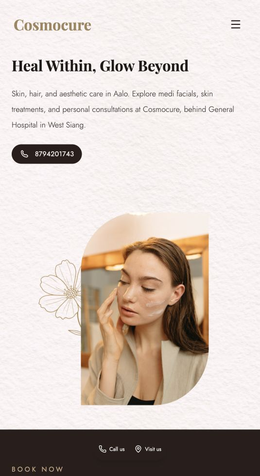

# Cosmocure

Skin, hair and aesthetic care in Aalo, Arunachal Pradesh.

[Visit the website](https://www.cosmocure.clinic/) · [Treatments](https://www.cosmocure.clinic/services) · [Contact and opening hours](https://www.cosmocure.clinic/contact)



## Features

- Paper texture, gold floral and celestial drawings, and varied image frames.
- A distinct WebP image set for every treatment block, with gentle automatic changes and no play/pause buttons.
- A 3-second GSAP welcome screen without a loading bar and restrained page reveals. Reduced-motion settings are respected.
- Mobile side navigation, compact Call us / Visit us controls, and consistent heading sizes.
- Sunday hours: **9 AM–7 PM**. Monday–Saturday: **9 AM–10 PM**.
- Page-specific search metadata, clinic structured data, sitemap and PNG social-sharing image.

## Development

```bash
pnpm install
pnpm dev
```

## Verification

```bash
pnpm build
pnpm test:footer
pnpm lint
pnpm start
```

The page checks run against the built HTML. See [SEO setup](docs/seo.md) and [image notes](docs/imagery.md).

## Hosting cost controls

Public pages are prerendered by Next.js. Keep request-time APIs and database
reads out of these pages unless a feature needs them. Compressed images are
served directly; Vercel image transformations are disabled.

`vercel.json` lets browsers reuse public assets for one hour. Stable file
names are not marked immutable, so changed files can refresh after that hour.
HTML keeps the platform cache policy. Do not apply these public cache headers
to private customer files, authentication, or transactional endpoints.

Bot controls and spending alerts are separate Vercel project/team settings.
Caching does not remove bandwidth charges for first visits or bot traffic.
